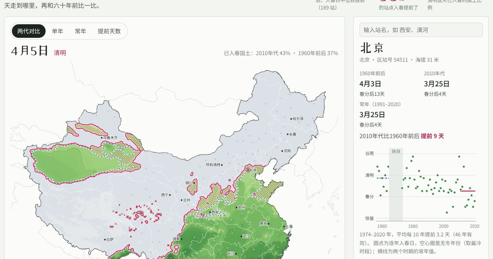

# 春线北上

一张会动的中国入春地图：按国家标准《气候季节划分》，用 562 个气象站 1957–2020 年的逐日气温，画出春天每天从华南推向北方的“春线”，并和六十年前比一比。

**在线体验：** https://wanglu2016.github.io/chunxian-beishang/
**使用讲解视频（3分47秒）：** https://wanglu2016.github.io/chunxian-beishang/video.html



## 能做什么

- **看春天往北走：** 拖动标着二十四节气的日历，或点播放键，春线逐日从南岭推到东北。走过的春线会留下细线，看得出每个节气那天春天到了哪里。
- **两代对比：** 2010 年代（实线）和 1960 年前后（虚线）同一天的春线叠在一起，粉色斜纹是“六十年前这一天还没入春、现在已经入春”的地方。下方曲线显示每天已入春的国土比例。
- **单年与常年：** 任选 1957–2020 年中的一年（1965–1973 年缺资料），和 1991–2020 年的常年对照，看那年春天是早是晚。
- **提前天数：** 两个时代直接相减，粉色越深提前越多，蓝色是推迟。
- **查一个地方：** 鼠标停在地图上显示那里哪天入春、赶上哪个节气；点击气象站或在搜索框输入站名，查看它历年的入春日和变化趋势。
- **省会城市对照表：** 各省会两个时期的常年入春日和提前天数，可排序。

一句话结论：两个时期资料都完整的 189 个站里，95% 入春提前了，中位数提前 9 天；清明那天已入春的国土从 37% 增加到 43%。

## 下载

- **离线版网页（约 1.6 MB）：** [chunxian-beishang-site.zip](https://github.com/wanglu2016/chunxian-beishang/raw/main/download/chunxian-beishang-site.zip)。解压后双击 `index.html` 即可使用，不需要联网或安装任何软件。
- **讲解视频（44 MB）：** [春线北上_使用指南.mp4](https://github.com/wanglu2016/chunxian-beishang/raw/main/video/chunxian-beishang-guide.mp4)，也可以在[视频页](https://wanglu2016.github.io/chunxian-beishang/video.html)点“下载视频”。
- **全部源代码：** 页面右上角绿色的 **Code → Download ZIP**（含视频，约 47 MB；解压后同样可以双击 `index.html` 离线使用）。

需要较新的 Chrome、Edge、Safari 或 Firefox。手机也可以使用。

## 怎么算“入春”

依据 GB/T 42074—2022《气候季节划分》（前身为 QX/T 152—2012）：

1. 每天算一次“5 天滑动平均气温”，即当天和前 4 天日平均气温的平均值。
2. 滑动平均连续 5 天都 ≥10℃ 时，在这 5 个滑动值用到的 9 天实测日平均气温里，取第一个 ≥10℃ 的日期作为入春日。
3. 入春后如果又出现连续 5 天滑动平均 <10℃，比较两段之间达标和不达标的天数，不达标的多就重新判定（“二次判断”）。本页对入冬也做同样判断。
4. 冬半年（11 月至次年 3 月）始终没有冬季过程，记为“无冬”；到 8 月底仍未入春，记为“无春”。

“1960年前后”“2010年代”和“常年”都按该时期的平均气温曲线计算，和气象部门公布“常年入春日”的做法一致。

## 注意事项

- **数据只到 2020 年。** 本项目使用的 GSOD 镜像只更新到 2020 年，所以“近期”是 2011–2020 年。
- **1965–1972 年中国站点在 GSOD 中几乎整段缺失**，所以“1960年前后”只能用 1957–1964 年；1973 年缺前一年秋冬的资料，没有画成全国地图。
- **单站单年的日期是“大致”。** GSOD 的日平均气温按世界时计日（北京时间 8 时到次日 8 时），与气象部门略有差别。北京 1981–2010 年常年入春日与官方一致（3月30日），2018 年一致（3月22日），2020 年差 3 天；临界年份可能差得更多（如上海 2016 年）。
- **地图上的面是插值结果。** 新疆南部、青藏高原西部站点稀少，那里的线只能看大势。
- **大城市站的提前有一部分来自城市热岛**；个别站点（如贵阳）的“推迟”可能与迁站有关，本项目没有逐一处理迁站。
- **底图仅作示意，未经中国地图审核。** 国界、省界取自中国气象局开源工具 meteva 所附数据；如需在中国大陆公开发布地图，应换用自然资源部标准地图服务的底图并标注审图号。
- **数据用途：** GSOD 中非美国站点的资料按世界气象组织第 40 号决议提供，仅限研究、教育等非商业用途。

## 数据来源与许可

| 内容 | 来源 | 许可 |
|---|---|---|
| 逐日平均气温 | NOAA 全球地面日值资料 [GSOD](https://www.ncei.noaa.gov/data/global-summary-of-the-day/)，经 GitHub 镜像 [CalebBell/gsod](https://github.com/CalebBell/gsod) 获取 | 美国政府数据；非美国站点仅限非商业用途（WMO 第 40 号决议） |
| 国家站中文名、坐标、海拔；1 公里地形；国界、省界、南海诸岛线划 | 中国气象局国家气象中心开源工具 [meteva](https://github.com/nmcdev/meteva) 所附资源 | Apache-2.0 |
| 港澳台及老站号位置 | NOAA ISD 站点历史（经 [GSODR](https://github.com/ropensci/GSODR) 打包）、[Meteostat 站点表](https://github.com/meteostat/weather-stations) | 美国政府数据；CC BY 4.0 |
| 入春标准 | GB/T 42074—2022《气候季节划分》 | — |
| 二十四节气日期 | 用 [PyEphem](https://rhodesmill.org/pyephem/) 按太阳视黄经逐年计算（北京时间） | — |
| 脚本库 | [d3](https://d3js.org/) 7.8.5、[pako](https://github.com/nodeca/pako) 2.1.0 | ISC；MIT/Zlib（见 `assets/vendor/`） |
| 字体 | Noto Sans SC、ZCOOL XiaoWei（站酷小薇），按本项目用字裁剪 | SIL OFL 1.1（见 `assets/fonts/`） |

城市中文站名中港澳台部分由 AI（Claude）翻译，可能有错漏，欢迎在 Issues 中指出。

## 项目结构

```
index.html          入春地图（单文件，无需构建）
video.html          讲解视频页
download/           离线版压缩包
assets/             数据 data.js、脚本库、字体、图片
video/              讲解视频
tools/              数据处理脚本，见 tools/README.md
```

本地运行：直接双击 `index.html`；或在项目目录运行 `python3 -m http.server`，再打开 http://localhost:8000 。
